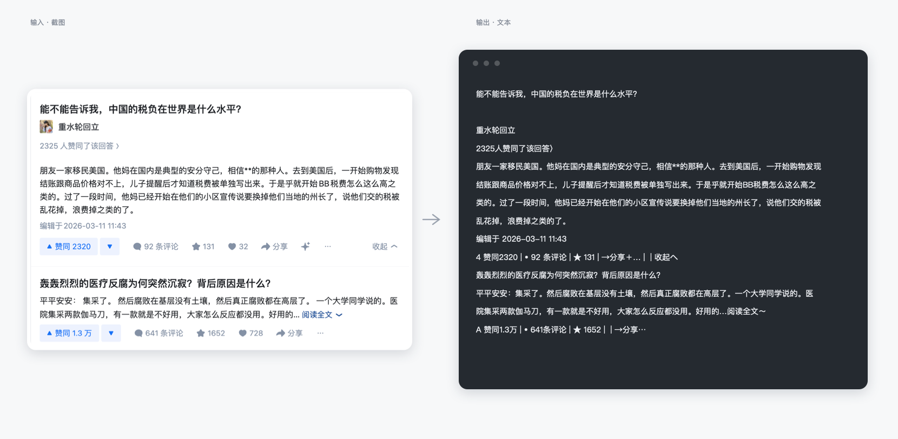
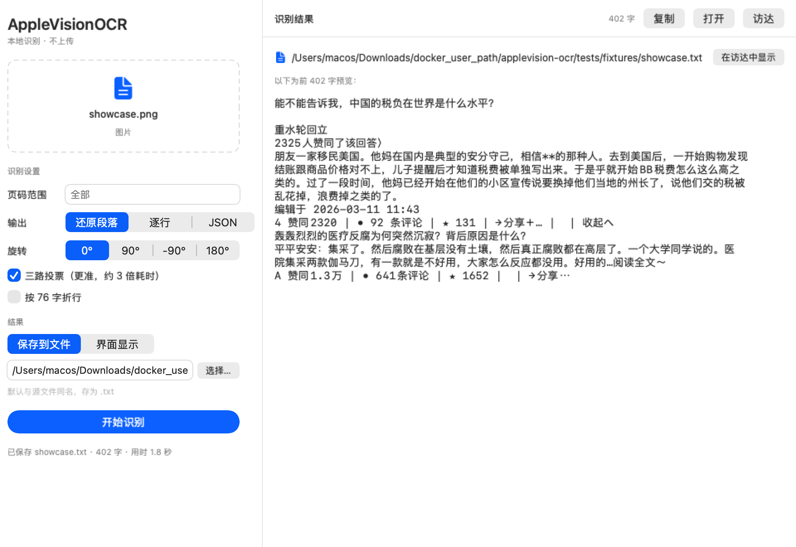

> 🇨🇳 **中文** · 🇺🇸 [English](README.en.md)

# applevision-ocr

本地 OCR：把扫描版 PDF 和图片变成可读文本，中文段落、表格、脚注都能还原。

基于 macOS 自带的 **Vision** 框架，全部在本机完成，不联网、不上传、不需要 API key。



*上面这张图就是真实效果：左边是原始截图，右边是 `applevision-ocr` 直接吐出的文本，命令 `applevision-ocr 截图.png --no-vote`，没有二次编辑。*

## 为什么是它

- **纯本地**：调用系统 Vision，无网络请求，敏感文档不用担心外流。
- **扫描版也能读**：PDF 没有文字层、复制出来是空白，这类文件只能靠 OCR。
- **中文准确率靠多路投票**：同一页按三个分辨率各识别一遍，逐字投票，消掉单字误识。
- **还原版式**：按缩进切段、跨页续接、表格转网格、脚注收进文末、图题转占位。
- **两种用法同一套引擎**：图形界面 `AppleVisionOCR.app`，命令行 `applevision-ocr`。

## 安装

需要 macOS 13+、Xcode Command Line Tools（`xcode-select --install`）和 python3（系统自带的即可）。

```bash
git clone <repo-url> applevision-ocr
cd applevision-ocr
make install          # 编译引擎 + 安装命令到 ~/.local/bin
make install-app      # 打包 AppleVisionOCR.app 到 ~/Applications
```

`make install` 会做三件事：编译 Swift 引擎到 `bin/ocrvision`、把 Python 包装到 `~/.local/share/applevision-ocr`、在 `~/.local/bin` 放一个 `applevision-ocr` 启动器。

## 用法

### 图形界面

```bash
open ~/Applications/AppleVisionOCR.app
```



拖入 PDF 或图片 → 选页码和输出形态 → 开始识别 → 复制或保存。
支持 `Cmd+O` 打开、`Cmd+S` 导出、`Cmd+R` 开始；在访达里双击 PDF 也可以直接用本应用打开。

### 命令行

```bash
applevision-ocr book.pdf                      # 整本 → book.txt
applevision-ocr book.pdf -p 26-142 -o out.txt # 指定页码范围
applevision-ocr scan.png                      # 图片 → 终端
applevision-ocr a.pdf b.pdf -o out/           # 批量，输出到目录
applevision-ocr paper.pdf --lang en-US        # 纯英文文档
```

常用参数：

| 参数 | 说明 |
| --- | --- |
| `-p, --pages 26-40` | 页码范围（仅 PDF） |
| `-o, --out` | 输出文件；多个输入时视为目录 |
| `--mode layout\|text\|json` | 还原段落（默认）/ 逐行 / 带坐标 JSON |
| `--scales 3.5,4.5,5.6` | 投票用的渲染倍率，只给一个即关闭投票 |
| `--no-vote` | 关闭多路投票，快约 3 倍 |
| `--rot -90` | 整页旋转后识别，处理横排大表 |
| `--wrap 76` | 按字数折行 |
| `--no-tables` | 不还原表格 |
| `--furniture off` | 不自动去页眉页脚（截图类文档用） |
| `--notes end\|drop` | 脚注收在文末 / 丢弃 |
| `--lang zh-Hans,en-US` | 识别语言 |

## 它是怎么做的

```
PDF/图片 ──► 引擎(Swift+Vision) ──► 逐行 JSON(带坐标)
                                      │
                     3 个分辨率各跑一遍 ─┴─► 逐字投票
                                      │
                                 版式还原 ──► 文本
```

1. **渲染与识别**：`src/engine/ocrvision.swift` 用 PDFKit 把每页渲染成位图，交给 `VNRecognizeTextRequest`，输出带归一化坐标的文本行。
2. **多路投票**：单路识别在中文上会稳定地把「的」读成「钓/前/哟」，但错误随分辨率变化。三路投票后大部分单字错误消失；「的」额外加权，因为它被漏掉的概率远高于被误增。
3. **版式还原**：跨页重复的页眉页脚按数字归一后的频次剔除；段落靠首行缩进识别；字号偏小的行判为脚注；短行密集的页按坐标聚成表格；图题转成占位说明。
4. **错字修正**：Vision 在中文印刷体上的固定偏差（`钓→的`、`AT→AI`、`欢盟→欧盟` 等），规则集中在 `src/applevision_ocr/fixes.py`。

细节见 [docs/architecture.md](docs/architecture.md)。

## 性能

| 场景 | 耗时 |
| --- | --- |
| 单页图片 | ≈ 0.9 秒 |
| 书页（3 路投票） | ≈ 2.4 秒/页 |
| 258 页扫描书 | ≈ 12 分钟 |

`--no-vote` 可把书页降到约 0.8 秒/页，代价是单字错误变多。

## 已知限制

- 手写体、艺术字识别率低。
- 整页旋转的复杂表格，`--rot` 后能读出内容但列可能对不齐。
- 曲线图、示意图只能给出图题占位，无法还原图形。
- 竖排古籍需要另行处理，默认按横排。

## 开发

```bash
make test     # 单元测试（不需要 macOS API，纯逻辑）
make engine   # 只编译引擎
make clean    # 清理构建产物
```

目录结构：

```
src/engine/           Swift OCR 引擎
src/applevision_ocr/  Python 包：投票、版式、修正、CLI
app/                  SwiftUI 界面
scripts/              构建、安装、图标
tests/                单元测试
docs/                 架构说明与截图
```

## 许可证

MIT。见 [LICENSE](LICENSE)。

名称里的 **Apple** 与 **Vision** 是 Apple Inc. 的商标，此处仅用于说明本工具依赖的技术。本项目与 Apple Inc. 无任何关联，也未获得其背书；若要在 App Store 或商业场景分发，请改用你自己的产品名。
